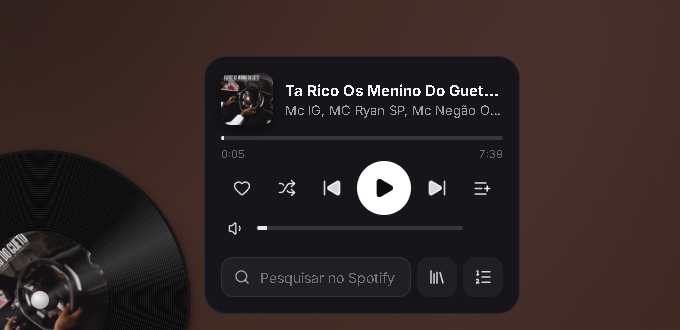

<div align="center">


# Whim

**Your desktop, moving to the music.**
Album art, synced lyrics and a neon glow for Spotify, on Windows.

[](https://github.com/akrysz-exe/whim-releases/releases/latest)
[](https://github.com/akrysz-exe/whim-releases/releases)


### [⬇ Download Whim](https://github.com/akrysz-exe/whim-releases/releases/latest)


</div>

## What it is

Whim turns your desktop into a music screen. While Spotify plays, the album art and lyrics appear over your wallpaper, a neon line traces the edge of the screen in the colours of the song, and a record in the corner gives you the controls.

- 🎵 **Plays inside the app.** You don't need Spotify open.
- 🖼️ **Album art and synced lyrics**, word by word, over your wallpaper (works with Wallpaper Engine). After 5 minutes paused, your wallpaper comes back.
- 🌈 **Neon around the screen edge**, in the album's colours or in rainbow, with waves that react to the sound. Thickness and wave height are adjustable.
- 💿 **A record in the corner**, always at hand on the desktop:
  - play and pause, skip, seek and volume;
  - save to your Liked Songs, shuffle, search;
  - your playlists and the "Up next" queue, which you can reorder by dragging.
- ⌨️ **Global shortcuts** that work in any window, even in games.
- 🖥️ **Multiple monitors:** you choose which one Whim lives on.
- 🪶 **Lightweight.** When a game or a window covers the screen, the animations pause on their own.
- 🔄 **Updates itself:** new versions install when you close Whim.

<div align="center">

</div>

## Installation

1. Download **`Whim-Setup-x.y.z.exe`** from the [latest release](https://github.com/akrysz-exe/whim-releases/releases/latest).
2. Open it. Installation is automatic, needs no administrator rights and creates a **Whim** shortcut on your desktop.
3. Whim opens by itself and walks you through connecting your Spotify account.

> [!NOTE]
> **"Windows protected your PC"?** Whim isn't signed with a paid certificate, so Windows SmartScreen warns you the first time. Click **More info → Run anyway**.
> Alternatively, before opening it: right-click the file → **Properties** → tick **Unblock** → OK.
> Automatic updates don't show this warning.

## Connecting Spotify

Whim uses Spotify's official API. For that, Spotify requires a "developer app", and only lets these apps be used if their owner has **Premium**. The setup depends on your account:

| | 👑 Premium | 🆓 Free |
| --- | :---: | :---: |
| Album art, synced lyrics and neon | ✅ | ✅ |
| Play / pause, skip, seek, volume | ✅ | ✅ |
| Search and save to Liked Songs | ✅ | ✅ |
| Library: browse and play your playlists | ✅ | ✅ |
| Add songs to your playlists | ✅ | ✅ |
| "Up next" queue (view, reorder, add) | ✅ | ❌ |
| Where the music plays | inside Whim | Spotify's web player, inside Whim |
| Ads | ❌ | ✅ (Spotify Free's own) |
| Developer app | you create your own | you use a Premium friend's |

### 👑 If you have Premium

You create your own developer app. It's free, takes 2 minutes, and Whim shows these steps the first time it opens:

<table>
<tr>
<td width="55%">

1. Open the [Spotify Developer Dashboard](https://developer.spotify.com/dashboard) and click **Create app**.
2. Give it any name, for example *Whim*.
3. Under **Redirect URI**, paste:
   ```
   http://127.0.0.1:43821/callback
   ```
4. Tick **Web API** and **Web Playback SDK**, accept the terms and save.
5. Copy the app's **Client ID** and paste it into Whim.
6. Click **Sign in with Spotify** and log in in your browser. "Continue with Google" works too.

Done: the music plays inside Whim.

</td>
<td>

</td>
</tr>
</table>

### 🆓 If you have Spotify Free

Spotify doesn't let Free accounts own developer apps, so **you use the app of a Premium friend** who already uses Whim. Each app accepts up to 5 people.

**Your Premium friend does** (once):
1. In the [Spotify Developer Dashboard](https://developer.spotify.com/dashboard), open their app → **Settings → User Management**.
2. Add your name and the **email of your Spotify account**.
3. Send you the app's **Client ID**. It isn't a secret: it only identifies the app and gives no access to their account.

**You do:**
1. In Whim, skip step 1 and paste your friend's **Client ID** in step 2.
2. Click **Sign in with Spotify** and log in in your browser with **your own** account.
3. A **"Log in to Spotify"** window opens with Spotify's web player. Log in there too with your account, using email and password or a code sent by email. The Google button doesn't work in this window.
4. Done: the music plays through the web player, inside Whim, with Spotify Free's usual ads and limits.

> [!NOTE]
> Using your friend's app does **not** mix your accounts. Each of you signs in with your own account and hears your own music and playlists. Your friend can't see what you listen to.

## Shortcuts

They work in any window and you can change them in Settings.

| Action | Shortcut |
| --- | --- |
| Play / pause | <kbd>Ctrl</kbd> + <kbd>Alt</kbd> + <kbd>Space</kbd> |
| Next track | <kbd>Ctrl</kbd> + <kbd>Alt</kbd> + <kbd>→</kbd> |
| Previous track | <kbd>Ctrl</kbd> + <kbd>Alt</kbd> + <kbd>←</kbd> |
| Volume up / down | <kbd>Ctrl</kbd> + <kbd>Alt</kbd> + <kbd>↑</kbd> / <kbd>↓</kbd> |
| Toggle the neon | <kbd>Ctrl</kbd> + <kbd>Alt</kbd> + <kbd>N</kbd> |

Your keyboard's media keys (⏯ ⏭ ⏮) work too.

## Settings

Settings open with a click on the Whim icon in the system tray, next to the clock. There you can adjust:
- the neon: colours, waves, thickness and wave height;
- lyrics sync;
- starting with Windows;
- the shortcuts.

In the tray menu (right-click the icon) you can also pick the monitor, if you have more than one.

<div align="center">

</div>

## FAQ

<details>
<summary><b>Is it safe?</b></summary>

- You log in in your own browser, on Spotify's official page. Whim never sees your password.
- The authorization is stored only on your PC, encrypted by Windows.
- Whim doesn't collect or send data anywhere. It only talks to Spotify, to [LRCLIB](https://lrclib.net) (lyrics) and to this repository (updates).
- To draw the waves, it reads the spectrum of your system's sound. Nothing is recorded.
</details>

<details>
<summary><b>The lyrics are early or late</b></summary>

Adjust it in **Settings → Lyrics → Lyrics sync**. Lyrics come from LRCLIB, and some songs don't have synced lyrics.
</details>

<details>
<summary><b>I can't see the record or the backdrop</b></summary>

They live on the desktop, under your windows. Press <kbd>Win</kbd> + <kbd>D</kbd> to see them. The backdrop only shows while music is playing.
</details>

<details>
<summary><b>How do I uninstall it?</b></summary>

Windows Settings → **Apps → Installed apps** → **Whim** → Uninstall.
</details>

<details>
<summary><b>I found a problem</b></summary>

Open an [issue](https://github.com/akrysz-exe/whim-releases/issues) describing what happened and attach the diagnostics file. To find it, paste `%APPDATA%\Whim\diagnostics.log` into File Explorer's address bar.
</details>

## Requirements

- Windows 10 or 11 (64-bit)
- A Spotify account: Premium, or Free with a Premium friend's app ([see above](#connecting-spotify))
- An internet connection

---

<div align="center">
<sub>Made by <b>akry_sz</b> · Whim is a personal project and is not affiliated with, sponsored or endorsed by Spotify. Spotify is a registered trademark of Spotify AB.</sub>
</div>
