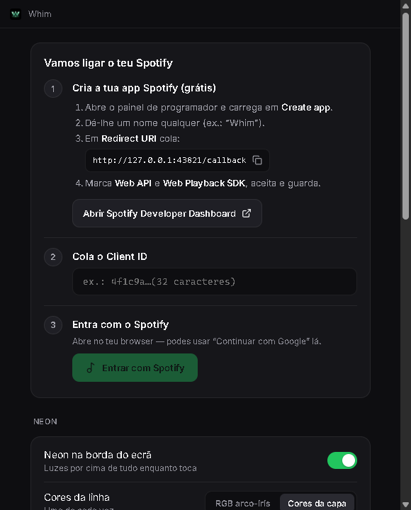
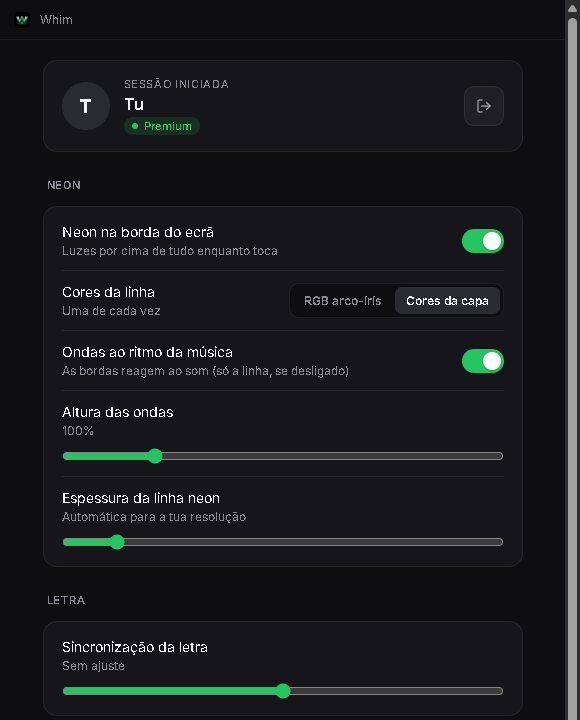

<div align="center">


# Whim

**O teu ambiente de trabalho ao ritmo da música.**
Capa, letra sincronizada e neon para o Spotify, no Windows.

[](https://github.com/akrysz-exe/whim-releases/releases/latest)
[](https://github.com/akrysz-exe/whim-releases/releases)


### [⬇ Descarregar o Whim](https://github.com/akrysz-exe/whim-releases/releases/latest)


</div>

## O que é

O Whim transforma o ambiente de trabalho num ecrã de música. Enquanto o Spotify toca, a capa do álbum e a letra aparecem por cima do papel de parede, uma linha neon contorna o ecrã com as cores da música, e um disco no canto dá-te os controlos.

- 🎵 **Toca dentro da app.** Não precisas de ter o Spotify aberto.
- 🖼️ **Capa e letra sincronizadas**, palavra a palavra, por cima do papel de parede (funciona com o Wallpaper Engine). Depois de 5 minutos em pausa, o teu papel de parede volta.
- 🌈 **Neon na borda do ecrã**, com as cores da capa ou em arco-íris, e ondas que reagem ao som. A espessura e a altura das ondas são ajustáveis.
- 💿 **Disco no canto**, sempre à mão no ambiente de trabalho:
  - tocar e pausar, saltar, posição da música e volume;
  - guardar nas tuas músicas, modo aleatório, pesquisa;
  - as tuas playlists e a fila "A seguir", que podes reordenar arrastando.
- ⌨️ **Atalhos globais**, que funcionam em qualquer janela, até a jogar.
- 🖥️ **Vários monitores:** escolhes em qual o Whim aparece.
- 🪶 **Leve.** Quando um jogo ou uma janela tapa o ecrã, as animações param sozinhas.
- 🔄 **Atualiza-se sozinho:** as versões novas instalam-se quando fechas o Whim.

<div align="center">

</div>

## Instalação

1. Descarrega o **`Whim-Setup-x.y.z.exe`** da [última versão](https://github.com/akrysz-exe/whim-releases/releases/latest).
2. Abre-o. A instalação é automática, não pede permissões de administrador e cria um atalho **Whim** no ambiente de trabalho.
3. O Whim abre sozinho e mostra os passos para ligares a tua conta Spotify.

> [!NOTE]
> **"O Windows protegeu o computador"?** O Whim não está assinado com um certificado pago, por isso o Windows (SmartScreen) avisa na primeira vez. Carrega em **Mais informações → Executar assim mesmo**.
> Em alternativa, antes de abrir: botão direito no ficheiro → **Propriedades** → marca **Desbloquear** → OK.
> As atualizações automáticas não mostram este aviso.

## Ligar o Spotify

O Whim usa a API oficial do Spotify. O Spotify pede uma "app de programador" para isso, e só deixa usar estas apps se o dono tiver **Premium**. O caminho depende da tua conta:

| | 👑 Premium | 🆓 Free |
| --- | :---: | :---: |
| Capa, letra sincronizada e neon | ✅ | ✅ |
| Tocar / pausar, saltar, posição, volume | ✅ | ✅ |
| Pesquisa e guardar nas tuas músicas | ✅ | ✅ |
| Biblioteca: ver e tocar as tuas playlists | ✅ | ✅ |
| Guardar músicas nas tuas playlists | ✅ | ✅ |
| Fila "A seguir" (ver, reordenar, adicionar) | ✅ | ❌ |
| Onde toca a música | dentro do Whim | leitor web do Spotify, dentro do Whim |
| Anúncios | ❌ | ✅ (os do Spotify Free) |
| App de programador | crias a tua | usas a de um amigo Premium |

### 👑 Se tens Premium

Crias a tua própria app de programador. É grátis, demora 2 minutos e o Whim mostra estes passos na primeira vez que abre:

<table>
<tr>
<td width="55%">

1. Abre o [Spotify Developer Dashboard](https://developer.spotify.com/dashboard) e carrega em **Create app**.
2. Dá-lhe um nome qualquer, por exemplo *Whim*.
3. Em **Redirect URI**, cola:
   ```
   http://127.0.0.1:43821/callback
   ```
4. Marca **Web API** e **Web Playback SDK**, aceita os termos e guarda.
5. Copia o **Client ID** da app e cola-o no Whim.
6. Carrega em **Entrar com Spotify** e faz login no browser. Podes usar "Continuar com Google".

Pronto: a música toca dentro do Whim.

</td>
<td>

</td>
</tr>
</table>

### 🆓 Se tens Spotify Free

Como o Spotify não deixa contas Free serem donas de apps de programador, **usas a app de um amigo com Premium** que já use o Whim. Cada app aceita até 5 pessoas.

**O teu amigo Premium faz** (uma vez):
1. No [Spotify Developer Dashboard](https://developer.spotify.com/dashboard), abre a app dele → **Settings → User Management**.
2. Adiciona o teu nome e o **email da tua conta Spotify**.
3. Envia-te o **Client ID** da app dele. Não é segredo: só identifica a app, não dá acesso à conta dele.

**Tu fazes:**
1. No Whim, salta o passo 1 e cola o **Client ID** do teu amigo no passo 2.
2. Carrega em **Entrar com Spotify** e faz login no browser com a **tua** conta.
3. Abre-se uma janela **"Inicia sessão no Spotify"** com o leitor web do Spotify. Entra lá também com a tua conta, com email e palavra-passe ou com um código por email. O botão do Google não funciona nesta janela.
4. Pronto: a música toca pelo leitor web, dentro do Whim, com os anúncios e limites normais do Spotify Free.

> [!NOTE]
> Usar a app do teu amigo **não** mistura as contas. Cada um entra com a sua conta e ouve as suas músicas e playlists. O teu amigo não vê o que ouves.

## Atalhos

Funcionam em qualquer janela e podes mudá-los nas Definições.

| Ação | Atalho |
| --- | --- |
| Tocar / pausar | <kbd>Ctrl</kbd> + <kbd>Alt</kbd> + <kbd>Espaço</kbd> |
| Música seguinte | <kbd>Ctrl</kbd> + <kbd>Alt</kbd> + <kbd>→</kbd> |
| Música anterior | <kbd>Ctrl</kbd> + <kbd>Alt</kbd> + <kbd>←</kbd> |
| Subir / baixar volume | <kbd>Ctrl</kbd> + <kbd>Alt</kbd> + <kbd>↑</kbd> / <kbd>↓</kbd> |
| Ligar / desligar o neon | <kbd>Ctrl</kbd> + <kbd>Alt</kbd> + <kbd>N</kbd> |

As teclas multimédia do teclado (⏯ ⏭ ⏮) também funcionam.

## Definições

As Definições abrem com um clique no ícone do Whim na bandeja, junto ao relógio. Lá ajustas:
- o neon: cores, ondas, espessura e altura das ondas;
- a sincronização da letra;
- o arranque com o Windows;
- os atalhos.

No menu da bandeja (botão direito no ícone) escolhes também o monitor, se tiveres mais de um.

<div align="center">

</div>

## Perguntas frequentes

<details>
<summary><b>É seguro?</b></summary>

- O login é feito no teu browser, na página oficial do Spotify. O Whim nunca vê a tua palavra-passe.
- A autorização fica guardada só no teu PC, cifrada pelo Windows.
- O Whim não recolhe nem envia dados para lado nenhum. Fala apenas com o Spotify, com o [LRCLIB](https://lrclib.net) (letras) e com este repositório (atualizações).
- Para desenhar as ondas, lê o espectro do som do sistema. Nada é gravado.
</details>

<details>
<summary><b>A letra está adiantada ou atrasada</b></summary>

Ajusta em **Definições → Letra → Sincronização da letra**. As letras vêm do LRCLIB, e algumas músicas não têm letra sincronizada.
</details>

<details>
<summary><b>Não vejo o disco nem o fundo</b></summary>

Estão no ambiente de trabalho, por baixo das janelas. Carrega em <kbd>Win</kbd> + <kbd>D</kbd> para os veres. O fundo só aparece enquanto há música a tocar.
</details>

<details>
<summary><b>Como desinstalo?</b></summary>

Definições do Windows → **Aplicações → Aplicações instaladas** → **Whim** → Desinstalar.
</details>

<details>
<summary><b>Encontrei um problema</b></summary>

Abre uma [issue](https://github.com/akrysz-exe/whim-releases/issues) com o que aconteceu e junta o ficheiro de diagnóstico. Para o encontrar, cola `%APPDATA%\Whim\diagnostics.log` na barra de endereço do Explorador de Ficheiros.
</details>

## Requisitos

- Windows 10 ou 11 (64 bits)
- Conta Spotify: Premium, ou Free com a app de um amigo Premium ([ver acima](#ligar-o-spotify))
- Ligação à internet

---

<div align="center">
<sub>Feito por <b>akry_sz</b> · O Whim é um projeto pessoal e não é afiliado, patrocinado nem aprovado pelo Spotify. Spotify é uma marca registada da Spotify AB.</sub>
</div>
